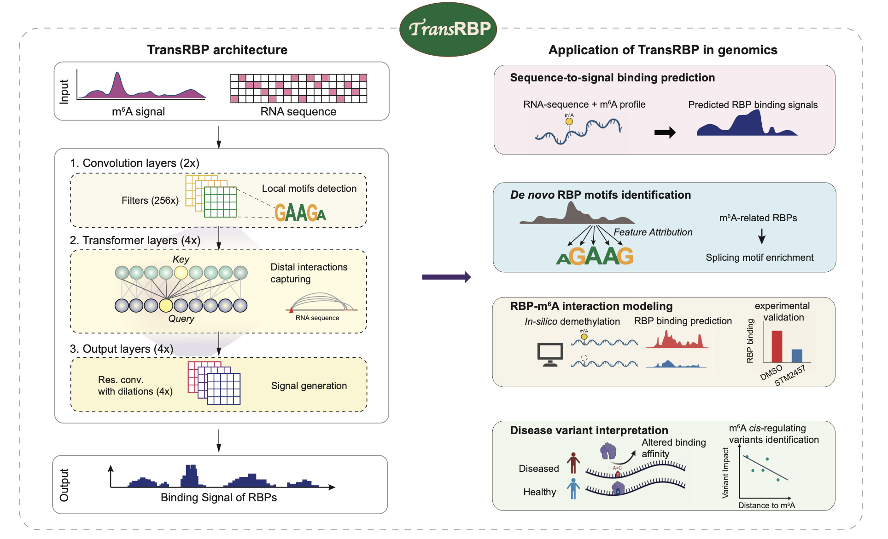

# TransRBP: m<sup>6</sup>A-Aware RBP Binding Prediction

TransRBP predicts RNA-binding protein (RBP) binding signal from sequence using a ResNet-Transformer architecture. The m6A-aware model adds a fifth input channel for m6A MeRIP-seq signal alongside the four-channel RNA one-hot encoding.

This repository contains the full model code, data preparation (eCLIP and MeRIP-seq tracks, no-homology splits), training (including multi-task pretraining / fine-tuning and the single-nucleotide GLORI m6A model), the RBPNet benchmark, evaluation, interpretation (full-model Integrated Gradients and motif discovery), in silico demethylation, variant impact scoring and the ClinVar disease-variant analysis. See [Reproducing the paper analyses](#reproducing-the-paper-analyses) for the scripts.



---

## Installation

```bash
git clone https://github.com/xiongxslab/TransRBP.git
cd TransRBP

conda env create -f environment.yml
conda activate transrbp

# Install the package in editable mode so all imports work from the repo root
pip install -e .
```

After `pip install -e .`, all scripts can be run directly from the `TransRBP/` directory without any path configuration:

```bash
cd TransRBP/
python evaluation/predict.py --help
```

---

## Download Pre-trained Data (Zenodo)

Pre-trained full model (5-channels) weights and train/val/test BED files for all 32 m6A-associated RBPs are available on Zenodo: [Zenodo](https://zenodo.org/records/21797682)

### How to organise after download

1. **Clone the repo and install:** (See Installation above)

2. **Download from Zenodo and place files inside the repo root.** The expected layout is:

```
TransRBP/                      ← repo root (git clone destination)
├── models/                    ← from Zenodo: pre-trained .pth files
│   ├── AKAP1.pth
│   ├── FMR1.pth
│   ├── UPF1.pth
│   └── ... (32 total)
├── data/                      ← from Zenodo: no-homology train/val/test BED splits
│   ├── FMR1_train.bed
│   ├── FMR1_val.bed
│   ├── FMR1_test.bed
│   └── ... (32 RBPs × 3 splits)
├── hg38/
│   ├── dna_sequence/          ← from Zenodo: per-chromosome gzipped FASTA
│   │   ├── chr1.fa.gz
│   │   ├── chr2.fa.gz
│   │   └── ...
│   └── all/                   ← from Zenodo: combined genome (for variant scoring)
│       ├── hg38.fa
│       └── hg38.fa.fai
├── m6A_bw/                    ← from Zenodo: MeRIP-seq BigWig (two files)
│   ├── m6A_plus.bw
│   └── m6A_minus.bw
├── model/                     ← code (in repo)
├── evaluation/                ← code (in repo)
└── ...
```

The Zenodo deposit contains four top-level folders: `models/`, `data/`, `hg38/`, `m6A_bw/`. Unzip each directly into the repo root.

| Zenodo folder        | Contents                                                                     |
| -------------------- | ---------------------------------------------------------------------------- |
| `models/`            | 32 `.pth` weight files (one per m6A-associated RBP)                          |
| `data/`              | Per-RBP train/val/test BED files (no-homology split)                         |
| `hg38/dna_sequence/` | Per-chromosome gzipped FASTA — used by predict, IG, demethylation            |
| `hg38/all/`          | Combined `hg38.fa` + index — used by variant impact scoring                  |
| `m6A_bw/`            | `m6A_plus.bw` and `m6A_minus.bw` (K562 MeRIP-seq log2 IP/input, the m6A input channel of the released models) |


---

## Quick Start with Pre-trained Models

### 1. Predict binding signal on genomic regions

Given any set of genomic regions (BED file), the model predicts the RBP binding signal using the local sequence and m6A context.

```bash
python evaluation/predict.py \
  --rbp_name   FMR1 \
  --peak_bed   data/FMR1_test.bed \
  --model_path models/FMR1.pth \
  --chrom_root hg38/dna_sequence \
  --m6A_bw_plus  m6A_bw/m6A_plus.bw \
  --m6A_bw_minus m6A_bw/m6A_minus.bw \
  --output_csv FMR1_predictions.csv \
  --output_h5  FMR1_predictions.h5    # optional: save full 800 bp tracks
```

**Input BED:** standard BED6 format (`chrom, start, end, name, score, strand`). Each row defines one 800 bp window; coordinates are used directly.

**Output CSV columns:**

| Column        | Description                               |
| ------------- | ----------------------------------------- |
| `peak_region` | `chr:start-end_strand`                    |
| `RBP_name`    | RBP identifier                            |
| `mean_pred`   | Mean predicted binding signal over 800 bp |
| `sum_pred`    | Sum of predicted signal over 800 bp       |
| `max_pred`    | Maximum predicted value over 800 bp       |

The optional `--output_h5` saves the full 800-position prediction vector per peak, keyed by `peak_region`.

---

### 2. Interpretation (Integrated Gradients, full model)

Computes attribution scores of the full 5-channel model with respect to **both** the sequence (A/U/C/G) and the m6A channel. These attributions are the input of the motif discovery below and of the aggregated sequence / m6A contribution profiles around RBP binding sites.

**Option A — BED file input (genomic peaks, with m6A signal):**

```bash
python interpretation/contrib_h5.py \
  --RBPname      FMR1 \
  --RBPmodel     models/FMR1.pth \
  --peak_bed     /path/to/FMR1_peaks.bed \
  --chrom_root   hg38/dna_sequence \
  --m6A_bw_plus  m6A_bw/m6A_plus.bw \
  --m6A_bw_minus m6A_bw/m6A_minus.bw \
  --out_h5_fname FMR1_contrib.h5 \
  --device       cuda:0
```

The 800 bp window is `[peak_start - 400, peak_start + 400)` (as in the paper); `--window center` anchors it on the peak midpoint instead.

**Option B — FASTA file input:**

```bash
python interpretation/contrib_h5.py \
  --RBPname      FMR1 \
  --RBPmodel     models/FMR1.pth \
  --fasta_file   sequences.fa \
  --out_h5_fname FMR1_contrib.h5 \
  --device       cuda:0
```

Sequences shorter than 800 nt are padded with N; longer sequences are trimmed. No genomic m6A signal is available for FASTA input, so the m6A channel is zero.


**Output HDF5 layout:**

```
FMR1/
  Contribution_Score/
    contrib_score_Batch_0    # (B, 5, 800) — channels 0-3 sequence (A, U, C, G), channel 4 m6A
    contrib_score_Batch_1
  Inputs/
    input_Batch_0            # (B, 5, 800) — one-hot sequence + m6A signal
    regions_Batch_0          # region strings (chr:start-end_strand or FASTA IDs)
```

### Motif discovery (k-mer clustering into PWMs)

From the per-RBP attribution files (`{RBP}.h5` from `contrib_h5.py`), the top 10,000 5-mers ranked by summed sequence contribution are extracted, clustered by one mismatch or a one-nucleotide shift into 7 × 4 position count matrices (PWMs), and the three best-supported PWMs of each RBP are kept:

```bash
python interpretation/motif_clustering.py --rbp_list rbp_list.txt --h5_dir contrib_h5/ --out_dir motif_out/
# motif_out/{RBP}/kmers_top10000.fasta     ranked k-mers
# motif_out/{RBP}/pwm/{seq}_pwm.npy        count matrix (7 x 4, columns A C G U) of every k-mer cluster
# motif_out/{RBP}/sequence_support.csv     clusters ranked by number of supporting k-mers
# motif_out/top3/{RBP}_{rank}_{seq}_pwm.npy, motif_out/top3/pwm_data.csv   top-3 PWMs of all RBPs
```

**After the PWMs.** The top-3 PWMs of the 32 RBPs (`top3/pwm_data.csv`, 28 flattened counts per motif) were converted to position frequency matrices and clustered with the R package motifStack (`clusterMotifs(..., revcomp = FALSE)`, `motifSignature(..., cutoffPval = 0.05, min.freq = 1, trim = 0.1)`), and displayed as a radial phylogram (`plotMotifStackWithRadialPhylog`).

---

### 3. In Silico Demethylation

Runs the model on each peak twice — with and without m6A signal — and reports the change in predicted binding.

```bash
# Complete KO: zero all m6A signal
python demethylation/insilico_demethylation.py \
  --rbp_name   FMR1 \
  --peak_bed   data/FMR1_test.bed \
  --model_path models/FMR1.pth \
  --chrom_root hg38/dna_sequence \
  --m6A_bw_plus  m6A_bw/m6A_plus.bw \
  --m6A_bw_minus m6A_bw/m6A_minus.bw \
  --output_csv FMR1_demethylation.csv

# Partial KO: zero only within supplied m6A peak sites as in the paper
python demethylation/insilico_demethylation.py \
  --rbp_name     FMR1 \
  --peak_bed     data/FMR1_test.bed \
  --model_path   models/FMR1.pth \
  --chrom_root   hg38/dna_sequence \
  --m6A_bw_plus  m6A_bw/m6A_plus.bw \
  --m6A_bw_minus m6A_bw/m6A_minus.bw \
  --m6A_peak_bed /path/to/m6A_sites.bed \
  --output_csv   FMR1_demethylation_partial.csv
```

**Input BED (`--peak_bed`):** standard BED6 format — `chrom, start, end, name, score, strand`

**m6A peak BED (`--m6A_peak_bed`):** Should be prepared by using MeRIP-seq m6A peaks or other m6A sequencing methods. As in the Methods section of paper, we used K562 MeRIP-seq (GEO GSE137752) aligned to hg38 with STAR (v2.7.11), peaks called with MACS2 (v2.2.6) using the matched RNA-seq data as control (narrowPeak).

**Output CSV columns:**

| Column               | Description                                                             |
| -------------------- | ----------------------------------------------------------------------- |
| `peak_region`        | `chr:start-end_strand` (800 bp window)                                  |
| `pred_diff`          | `sum(pred_KO − pred_original)` over 800 bp — negative = reduced binding |
| `mean_pred_KO`       | Mean prediction under KO input                                          |
| `mean_pred_original` | Mean prediction under original input                                    |
| `KLD_pred`           | KL divergence between KO and original binding profiles                  |
| `RBP_name`           | RBP identifier                                                          |

---

### 4. Mutagenesis / Variant Impact Scoring

Scores the effect of single-nucleotide variants on predicted RBP binding as the KL divergence KL(alt ‖ ref) between the alternative- and reference-allele 800 nt binding profiles.

The variant analyses use **both** model types: the sequence-only TransRBP (4-channel input, `--features 4`, default) and the full model (sequence + m6A, `--features 5`). The sequence-only models need to be trained by user, so **retrain one sequence-only model per RBP first** (see [Sequence-only models](#sequence-only-models-for-the-variant-analyses)) and pass it with `--model_path`.

```bash
python mutagenesis/variant_impact.py \
  --input_csv        variants.csv \
  --reference_genome hg38/all/hg38.fa \
  --model_path       models_seq_only/FMR1.pth \
  --output_tsv       FMR1_variants.tsv \
  --device           cuda:0
```

For the full model use `--model_path models/FMR1.pth --features 5 --m6A_bw_plus m6A_bw/m6A_plus.bw --m6A_bw_minus m6A_bw/m6A_minus.bw`; the m6A signal of the window is identical for the reference and alternative input.

**Input CSV format** (`variants.csv`):

```
chromosome, position, strand, allele_A, allele_B
chr1, 1000001, +, G, A
chr7, 5550020, -, C, T
```

- `position`: 1-based genomic coordinate
- `allele_A`: must match the reference base at that position on the given strand (case-insensitive)
- `allele_B`: the alternative allele to score (on the given strand)

**Output TSV columns:** `chromosome, position, strand, ref, alt, variant_score`
`variant_score` is KL(alt ‖ ref) (higher = more disruptive).

The ClinVar analysis of the paper is in `disease/` — see [ClinVar disease variants](#clinvar-disease-variants-fig-4-extended-data-fig-8-supplementary-tables-5-6).

---

## Preparing BigWig Tracks for re-train

### RBP eCLIP signal (training labels)

Strand-specific log2(eCLIP / SMInput) tracks were generated from ENCODE K562 eCLIP BAM files (IP replicates 1 and 2 and the size-matched input) as follows:

1. paired-end libraries: keep read 2 only (`samtools view -f 128`);
2. merge the two eCLIP replicates (`samtools merge`);
3. split by alignment strand (`samtools view -F 16` → plus, `samtools view -f 16` → minus), sort and index;
4. per strand, with deepTools v3.5.4:

```bash
bamCompare -b1 IP_plus_sorted.bam -b2 SMInput_plus_sorted.bam -o FMR1_plus.bw \
    --binSize 1 -bl eclip_blacklist.bed --operation log2 --scaleFactorsMethod readCount -of bigwig
```

(pseudocount = deepTools default 1). Negative log2 values are set to 0 when the tracks are read. All steps are in one script:

```bash
bash preprocessing/eclip_bigwig.sh FMR1 PE eclip_blacklist.bed bamCompare_bw/ \
    FMR1_IP_rep1.bam FMR1_IP_rep2.bam FMR1_SMInput.bam
```

Place the resulting `{RBP}_plus.bw` and `{RBP}_minus.bw` files in one directory (`--bw_root` in the training commands).

### m6A channel (MeRIP-seq)

`m6A_bw/m6A_{plus,minus}.bw` are log2(MeRIP IP / RNA-seq input) tracks of K562 MeRIP-seq (GSE137752; STAR-aligned), made with the same strand splitting and `bamCompare --binSize 1 --operation log2 --scaleFactorsMethod readCount` (no blacklist):

```bash
bash preprocessing/merip_bigwig.sh m6A_bw/ IP_rep1.bam,IP_rep2.bam input_rep1.bam,input_rep2.bam
```

m6A peaks (used for the distance of variants to m6A) are the K562 MeRIP-seq peaks called with MACS2 against the RNA-seq input and assigned the strand of the overlapping gene annotation, as described in Methods.

---

## Training from Scratch

### Option A — No-homology training (used for the 32 m6A-associated RBPs training in the paper)

**Step 0 (optional):** Generate the no-homology splits from the ENCODE K562 eCLIP replicated peaks (chr1-22) of each RBP (ENCODE experiment accessions in `preprocessing/encode_eclip_accessions.tsv`):

```bash
python preprocessing/get_encode_peaks.py --accessions preprocessing/encode_eclip_accessions.tsv \
  --rbp_list rbp_list.txt --out_dir RBP_bed/
```

Then Sliding 800 bp windows are sampled per chromosome split (14,000 train / 4,000 val / 2,500 test); test windows with a BLASTN hit to any training window (identity ≥ 80% over ≥ 50% of the window, e-value ≤ 1e-3) are removed and 2,000 test windows are kept. With `--seed 42` (default) this reproduces the Zenodo `data/` BED files. Requires BLAST+ (installed by `environment.yml`).

```bash
python training/make_nohomo_split.py \
  --rbp-list   rbp_list.txt \
  --peak-dir   /path/to/RBP_bed \
  --genome-dir hg38/dna_sequence \
  --out-dir    data/
```

**Step 1:** Generate HDF5 from pre-split BED files (from Zenodo or your own splits):

```bash
python training/make_h5_nohomo.py \
  --rbp        FMR1 \
  --bed_root   data/ \
  --bw_root    /path/to/bamCompare_bw \
  --chrom_root hg38/dna_sequence \
  --m6A_track  m6A \
  --output_dir ./h5_cache
```

`--m6A_track m6A` reads `m6A_plus.bw` / `m6A_minus.bw` (MeRIP-seq) from `--bw_root` and reproduces the released models.

To run all 32 RBPs in parallel:

```bash
RBPs=(AKAP1 APOBEC3C CPSF6 DDX3X DDX43 DDX55 DDX6 EIF4E FMR1 FTO \
      FXR1 FXR2 GEMIN5 GRWD1 IGF2BP1 LIN28B METAP2 MTPAP NOLC1 PABPC4 \
      PUM1 PUM2 RBM15 SLTM SRSF1 TRA2A UCHL5 UPF1 YBX3 YWHAG ZNF622 ZNF800)
for RBP in "${RBPs[@]}"; do
    python training/make_h5_nohomo.py --rbp $RBP --bed_root data/ ... &
done
wait
```

**Step 2:** Train:

```bash
python training/train_nohomo.py \
  --rbp            FMR1 \
  --h5_path        ./h5_cache/FMR1.h5 \
  --save_model_dir ./models \
  --output_csv     results.csv \
  --device         cuda:0
```

### Option B — Chromosome split (not recommended)

Pass the **full unfiltered ENCODE peak BED file from ENCODE** (not the pre-split Zenodo files). The dataset handles everything internally:
- **Chromosome split**: val = chr2/3/4, test = chr1/8/9, train = all others
- **Data augmentation**: slides an 800 bp window across each peak (step = peak\_length/10), generating multiple windows per peak
- **Downsampling**: randomly caps at 20,000 total windows (14,000 train / 4,000 val / 2,000 test)

```bash
python training/main.py \
  --rbp        FMR1 \
  --peak_bed   /path/to/FMR1_ENCODE_peaks.bed \
  --bw_root    /path/to/bamCompare_bw \
  --chrom_root hg38/dna_sequence \
  --m6A_bw_plus  m6A_bw/m6A_plus.bw \
  --m6A_bw_minus m6A_bw/m6A_minus.bw \
  --m6A_binding 1 \
  --save_model_dir ./models \
  --output_csv results.csv \
  --device cuda:0
```

---

## Reproducing the paper analyses

| Analysis | Script(s) |
| --- | --- |
| eCLIP / MeRIP-seq input tracks | `preprocessing/eclip_bigwig.sh`, `preprocessing/merip_bigwig.sh` |
| eCLIP peaks (ENCODE) and no-homology train/val/test splits (BLASTN filter) | `preprocessing/get_encode_peaks.py` → `training/make_nohomo_split.py` |
| TransRBP training on the no-homology splits | `training/make_h5_nohomo.py` → `training/train_nohomo.py` |
| RBPNet benchmark | `benchmark/rbpnet/export_fasta.py` → `benchmark/rbpnet/homology.sh` → `benchmark/rbpnet/train.py` |
| Full-model attribution (sequence + m6A channels) | `interpretation/contrib_h5.py` |
| Motif discovery | `interpretation/contrib_h5.py` → `interpretation/motif_clustering.py` |
| In silico demethylation | `demethylation/insilico_demethylation.py` |
| Sequence-only (4-channel) models for the variant analyses | `training/make_h5_nohomo.py --m6A_binding 0` → `training/train_nohomo.py --m6A_binding 0` |
| ClinVar disease variants: variant impact, RBP-specific cutoffs, association with distance to m6A | `disease/prepare_variants.py` → `disease/score_variants.py` |
| Multi-task pretraining and fine-tuning | `training/pretrain/run_pretrain_finetune.sh` |
| Single-nucleotide (GLORI) m6A model | `preprocessing/glori/run_preparation.sh` → `training/train_nohomo.py` |

Additional software: BLAST+ (splits, RBPNet benchmark; installed by `environment.yml`), samtools and deepTools 3.5.4 (BigWig tracks), MACS2 (m6A peaks).

### RBPNet benchmark

RBPNet is reimplemented in PyTorch and trained per RBP on 300 nt windows of the same eCLIP peaks, following the chromosome-split strategy described in the original paper ([RBPNet](https://link.springer.com/article/10.1186/s13059-023-03015-7)):

- **Training / validation:** windows are split by chromosome (validation chr2/3/4, test chr1/8/9, training all other chromosomes) and downsampled to 14,000 training and 4,000 validation windows.
- **Testing:** 2,500 windows are sampled from the test chromosomes; windows homologous to any training window (BLASTN, identity ≥ 80% over ≥ 50% of the window, e-value ≤ 1e-3) are excluded, and 2,000 test windows are kept.

`export_fasta.py` writes the training and test windows as FASTA, `homology.sh` runs BLASTN and lists the homologous test windows, and `train.py` trains and evaluates RBPNet on the filtered test set:

```bash
python benchmark/rbpnet/export_fasta.py --rbp rbp_list.txt --peak_root RBP_bed/ --bw_root bamCompare_bw/ \
    --chrom_root hg38/dna_sequence --out_dir rbpnet_fasta/
sh benchmark/rbpnet/homology.sh rbp_list.txt rbpnet_fasta/
python benchmark/rbpnet/train.py --rbp rbp_list.txt --peak_root RBP_bed/ --bw_root bamCompare_bw/ \
    --chrom_root hg38/dna_sequence --homology_id rbpnet_fasta/ --tb_dir rbpnet_tb/ --save_model_dir rbpnet_models/
```

### Multi-task pretraining and fine-tuning

A multi-task TransRBP (`model/pretrain/RBPMultiTaskModel.py`; same backbone, 2-layer position-wise head with 32 outputs) is pretrained jointly on the 32 m6A-associated RBPs (100,000 windows), and the head is then fine-tuned for each RBP (backbone frozen, 20,000 windows per RBP):

```bash
bash training/pretrain/run_pretrain_finetune.sh rbp_list.txt RBP_bed/ bamCompare_bw/ hg38/dna_sequence pretrain_out/ cuda:0
```

`bamCompare_bw/` must contain the RBP BigWigs and `m6A_plus.bw` / `m6A_minus.bw`. Steps: `preprocess_h5.py` → `main_pretrain.py` (lr 1e-3) → `eval_pretrain.py` → `preprocess_finetune_h5.py` → `finetune_singletask.py` (`--freeze_mode head_only`, lr 1e-4).

### Single-nucleotide (GLORI) m6A model

The m6A channel is replaced by a single-nucleotide GLORI track (`m6A_GLORI_K562proxy_{plus,minus}.bw`) built from GEO GSE210563:

1. `build_glori_consensus.py` — sites called in both replicates of HEK293T (GSM6432590/91) and of HeLa (GSM6432595/96); m6A level = mean of the replicates' normalised ratios;
2. `build_GLORI_union.py` — union of the HeLa and HEK293T sites;
3. `filter_by_rnaseq.py` — sites expressed in K562 (K562 MeRIP-seq Input control (RNA-seq) CPM > 0.5, `MeRIP_control_merged.bw` from `preprocessing/merip_bigwig.sh`);
4. `make_bigwig.py` — strand-specific sparse BigWig of the GLORI m6A level;
5. `training/make_h5_nohomo.py --m6A_track m6A_GLORI_K562proxy` — per-RBP inputs on the same no-homology splits.

```bash
bash preprocessing/glori/run_preparation.sh GSE210563_RAW/ m6A_bw/MeRIP_control_merged.bw \
    hg38/annotation/hg38.chrom.sizes glori_out/ bamCompare_bw/ rbp_list.txt h5_cache_GLORI/
python training/train_nohomo.py --rbp FMR1 --h5_path h5_cache_GLORI/FMR1.h5 \
    --save_model_dir models_GLORI/ --output_csv results_GLORI.csv --device cuda:0
```

The GLORI model is trained with the same procedure as the released models (`train_nohomo.py`).

### Sequence-only models for the variant analyses

The variant impact analysis is run with two model types:

- **Full model** (sequence + m6A): the released models (Zenodo `models/`) — no retraining needed.
- **Sequence-only model** (4-channel input, no m6A channel): **not included in the Zenodo deposit. Retrain one sequence-only model per RBP before running the variant impact analysis.**

Train the sequence-only models on the same no-homology splits (`data/{RBP}_{train,val,test}.bed`) and with the same procedure as the released models, for every RBP in `rbp_list.txt`:

```bash
while read RBP; do
    python training/make_h5_nohomo.py --rbp $RBP --bed_root data/ --bw_root bamCompare_bw/ \
        --chrom_root hg38/dna_sequence --m6A_binding 0 --output_dir h5_cache_seq_only/
    python training/train_nohomo.py --rbp $RBP --h5_path h5_cache_seq_only/$RBP.h5 --m6A_binding 0 \
        --save_model_dir models_seq_only/ --output_csv results_seq_only.csv --device cuda:0
done < rbp_list.txt
# models_seq_only/{RBP}.pth
```

Then use `models_seq_only/` for the variant impact analysis: `mutagenesis/variant_impact.py --model_path models_seq_only/{RBP}.pth` (default `--features 4`) and `disease/score_variants.py --models_dir models_seq_only/` (below). For the full model, pass `models/` with `--features 5` and the m6A BigWigs instead.

### ClinVar disease variants

**ClinVar version:** GRCh38 VCF release 2024-07-08 (`clinvar_20240708.vcf.gz`, `##fileDate=2024-07-08`), downloaded on 11 July 2024 from https://ftp.ncbi.nlm.nih.gov/pub/clinvar/vcf_GRCh38/.

**Step 1 — variants near RBP binding sites** (`disease/prepare_variants.py`). The ClinVar VCF is parsed; records of 26 brain, heart and lung disease traits are selected by keyword; single-nucleotide variants within 800 bp of each RBP's eCLIP peaks are kept (plus strand) and de-duplicated; the distance to the nearest MeRIP-seq m6A peak is computed. The output is the variant table without the variant-impact columns (`KLD`, `cutoff`, `Annotation`), which are added in step 2.

**The m6A peak file (`--m6A_peaks`) is not provided and should be generated by the user:** call peaks on the K562 MeRIP-seq data (GEO GSE137752) or any other m6A seq data with MACS2 using the matched RNA-seq input as control, and assign each peak the strand of the overlapping gene annotation, as described in Methods. The file is BED6 (`chrom, start, end, name, score, strand`); plus-strand peaks are used for the distance calculation.

```bash
python disease/prepare_variants.py \
    --vcf clinvar_20240708.vcf.gz --rbp_list rbp_list.txt --peak_dir RBP_bed/ \
    --chrom_sizes hg38/annotation/hg38.chrom.sizes --m6A_peaks MeRIP_peaks_stranded.bed \
    --out_dir disease_out/
# disease_out/clinvar_rbp_variants.tsv
#   RBPname, Chr, Position, Strand, Ref, Alt, Mutation_Type, Related_Tissue, Disease, Distance2m6A, Distance_Class
```

**Step 2 — variant impact (KLD) and association with m6A** (`disease/score_variants.py`). Each variant is scored with the RBP's TransRBP model (KLD = KL(alt ‖ ref)), either the sequence-only model (default, `--features 4`) or the full model (`--features 5`). The RBP-specific cutoff is the 90th percentile of the KLD of 100,000 background mutations (random positions within 800 bp of the RBP's peaks); variants with KLD ≥ cutoff are "RBP-dependent". The association between KLD and distance to the nearest m6A peak is tested per RBP × disease (Spearman; variants within 800 bp of m6A, n ≥ 10; Benjamini–Hochberg-adjusted P), and the variants of pairs with SCC < −0.4 and adjusted P < 0.01 are reported as m6A-dependent variants:

```bash
python disease/score_variants.py \
    --variants disease_out/clinvar_rbp_variants.tsv --models_dir models_seq_only/ \
    --reference_genome hg38/all/hg38.fa --peak_dir RBP_bed/ \
    --out_dir disease_out/ --device cuda:0
# disease_out/variant_impact.csv           all variants with KLD, cutoff, Annotation
# disease_out/m6A_dependent_variants.csv   variants of RBP x disease pairs with SCC < -0.4, BH-adjusted P < 0.01
# disease_out/m6A_distance_correlation.csv Spearman SCC, P and BH-adjusted P per RBP x disease
# disease_out/background_scores.csv        background mutation scores
```

Background mutations are sampled with `--seed` (default 43). For the full model, use `--models_dir models/ --features 5 --m6A_bw_plus m6A_bw/m6A_plus.bw --m6A_bw_minus m6A_bw/m6A_minus.bw`.

---

## Repository Structure

```
TransRBP/
├── model/
│   ├── RBPResTransModels.py    # TransRBP model (RBPModel class)
│   ├── TransformerBlocks.py    # Transformer encoder with attention recording
│   ├── resblocks.py            # Residual blocks
│   └── pretrain/
│       └── RBPMultiTaskModel.py   # multi-task (32-RBP) pretraining model
├── data/
│   ├── dataset.py              # Sliding-window dataset (BigWig + FASTA)
│   └── dataset_h5.py           # HDF5-backed dataset for no-homology training
├── preprocessing/
│   ├── get_encode_peaks.py     # ENCODE K562 eCLIP replicated peaks (chr1-22)
│   ├── encode_eclip_accessions.tsv
│   ├── eclip_bigwig.sh         # eCLIP log2(IP/SMInput) BigWig (bamCompare)
│   ├── merip_bigwig.sh         # MeRIP-seq m6A channel + input CPM track
│   └── glori/                  # GLORI single-nucleotide m6A track
├── training/
│   ├── main.py                 # Standard training (chromosome split)
│   ├── make_nohomo_split.py    # No-homology splits (sliding windows + BLASTN filter)
│   ├── make_h5_nohomo.py       # Pre-materialise HDF5 from no-homology BEDs
│   ├── train_nohomo.py         # No-homology training on HDF5
│   └── pretrain/               # Multi-task pretraining and per-RBP fine-tuning
├── benchmark/
│   └── rbpnet/                 # RBPNet baseline: dataset, model, BLASTN homology filter, training
├── evaluation/
│   └── predict.py              # Predict binding signal from BED + genome + m6A BigWig
├── interpretation/
│   ├── contrib_h5.py           # Full-model Integrated Gradients (sequence + m6A channels)
│   └── motif_clustering.py     # Top k-mers -> clustered PWMs
├── demethylation/
│   └── insilico_demethylation.py  # m6A KO analysis → pred_diff CSV
├── mutagenesis/
│   ├── variant_impact.py       # Variant scoring (KL divergence; sequence-only or full model)
│   └── variant_dataset.py      # Dataset helper for variant scoring
└── disease/
    ├── prepare_variants.py     # ClinVar variants near RBP peaks + distance to m6A
    └── score_variants.py       # KLD, background cutoffs, association with distance to m6A
```

---

## Citation

If you use TransRBP in your research, please cite:

> Jianche Liu<sup>#</sup>, Xinlu Zhu<sup>#</sup>, Yao An<sup>#</sup>, Yang Yin<sup>#</sup>, Zhoutong Xu, Aowen Wang, Zexiang Zhou, Jialin He, Lei Xiong, Xiaoyu Li<sup>\*</sup>, Xushen Xiong<sup>\*</sup>  
> **TransRBP unravels m6A-RBP interaction and reveals its disease implications**  
> *[Journal]* (2026). DOI: [DOI]
